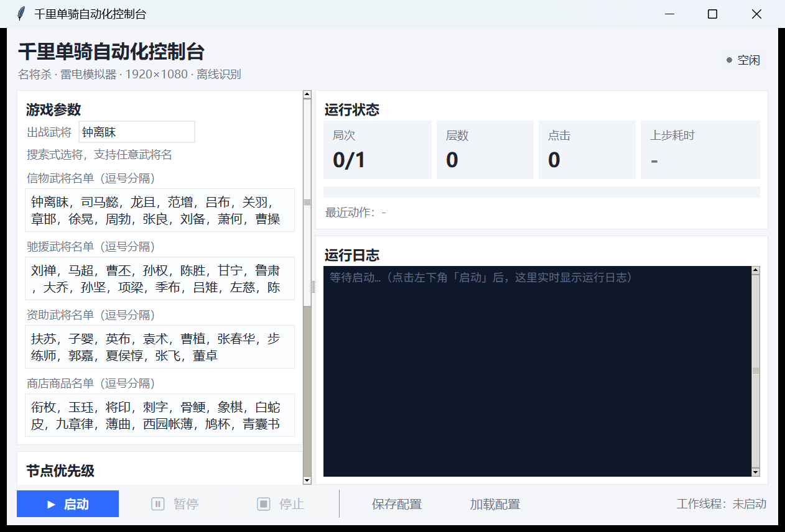

# 07 - 开发框架与分层（借鉴一条龙的取舍）



> 背景：2026-11-12 参考 `ZenlessZoneZero-OneDragon`（绝区零一条龙）的框架做了一次
> 结构化梳理。**原则：只借「框架思想」，不搬它的平台规模**——本项目是单人自用的
> 固定管线脚本，一旦为了"通用"而上重基建，速度与稳定性反而会下降。

## 一、当前分层（依赖只许自上而下）

```
run.py / mjs_gui.py          ← 入口：装配上下文、解析命令
        ↓
src/gui/                     ← 界面层
  app.py        控制器：收集配置、起停工作线程、轮询队列
  widgets.py    视图控件：LogView / StatusPanel / plan_log_append
  theme.py      主题（配色/字体/ttk 样式）
  config_store.py  配置读写 + 名单应用
        ↓（通过 status_cb 单向回调，不 import 业务）
src/game/                    ← 业务层（状态机 + 决策）
  runner.py     主循环 / 动作派发 / 操作序列
  anchor_table.py  锚点表（yml 数据驱动判页）
  settle_page.py / task_page.py / gift.py / rest.py / shop.py / hero_event.py …
        ↓
src/vision/  src/devices/    ← 感知层与控制器层
  ocr.py（RapidOCR）/ matcher.py / node_icon.py / adb.py
        ↓
src/core/  src/config.py     ← 基础设施（日志、重试、配置）
```

**硬约束（有架构测试 `tests/test_architecture.py` 守着）**

1. `src/game/**` 不得 import `tkinter` / `src.gui` —— 业务必须能脱离界面跑。
2. `src/vision/**`、`src/devices/**` 不得反向 import `src.game` / `src.gui`。
3. `src/gui/widgets.py` 不得 import 业务/视觉/设备（控件只做渲染）。
4. `src/gui/app.py` 对 `run.py` 的 import 必须在函数内（惰性）——
   否则 GUI 一开窗就加载 cv2/onnx，且「停止→改代码→启动」的重载会失效。
5. `src/core/asker.py` 是 tkinter 的唯一例外（决策提问本身要弹窗）。

## 二、借鉴了什么（以及为什么值得）

| 一条龙的做法 | 我们的落地 | 收益 |
|---|---|---|
| 画面用 YAML 建档（screen_info） | `assets/screen_info/anchors.yml` + `anchor_table.py` | 加页面=加一段 yml + 一张图，不改代码；判页 1.9s → 12–25ms |
| 操作链（operation round） | `runner._run_steps` / `_settle_sequence` / 开战序列 | 已知连击不再每步重截图+重分类，每场战斗少 3–5 个循环 |
| 画面锚点 + 多区域 AND | `areas[]` 多区域 AND（如地图=结束挑战+当前挑战） | 挡住"同按钮页面"误判（武将信息页 vs 地图） |
| GUI 与业务解耦 | `app.py`（控制器）/ `widgets.py`（控件） | 控件可离线单测（`plan_log_append`），业务可 CLI 跑 |
| 配置与界面绑定、变化才刷新 | `StatusPanel._set` 值变化才写 Tk 变量 | 轮询不再触发无意义重排 |
| 等待策略收口 | `_wait_ready(probe, timeout)` 统一"点击后就绪探测" | 固定 sleep 变"命中即走"，超时也不劣于旧行为 |
| 性能坑写进规范 | `AGENTS.md` + `docs/06` 性能红线 | 踩过的坑不再重踩（PNG 截图、重复 OCR、自旋线程…） |

## 三、明确**不抄**的东西（照抄会掉性能/增加维护）

| 一条龙的重基建 | 为什么不抄 |
|---|---|
| Qt6 + Fluent 全量 UI、几十个 View/Logic 分层 | 我们是单窗口控制台，tkinter + 自绘 ttk 主题够用；换框架要重做打包，收益为零 |
| 70+ 画面的 BFS 全图路由 | 我们的流程是固定管线（主页→入口→局内循环），线性状态机更简单可靠 |
| 插件生态（plugin.json / sha256 / 三仓发布） | 自用脚本无第三方扩展需求，纯维护负担 |
| 多账号实例隔离、应用组、跑完关机 | 无此场景 |
| onnxruntime-gpu（CUDA） | 要装 CUDA/cuDNN（约 1GB），分发即事故；改用 **DirectML** 版（Win10+ 自带 DX12 即可，无 GPU 自动回落 CPU） |
| CV Pipeline 可视化拖拽调参 | 调参频率低，模板裁剪 + 交叉验证脚本已覆盖 |
| 测试放独立仓 | 我们测试与源码强绑定（夹具即资产），放一起更省事 |

## 四、三条扩展配方（照做即可，不用读 runner 全文）

### 4.1 新增一个"页面识别"（锚点化）

1. 抓到该页面真实截图 → 放进 `tests/fixtures/xxx.png`；
2. 在 `tools/_make_anchor_table.py` 的 `SPEC` 里加一条：
   `(state, 夹具, 裁剪区, 搜索区, 阈值, needs_ocr, scope[, ocr_region])`；
   多锚点 AND 就写多条**同名 state**（自动编号 `state_1.png`）；
3. 跑 `python tools/_make_anchor_table.py` —— 它裁模板、生成 yml、
   并用**全部夹具做交叉验证**（只许命中自己那一页，其余零误报）；
4. 顺序即优先级：具体页在前、通用页在后（覆盖层 → 子页面 → 父页面 → battle）；
5. 若该页动作需要文本，把 `needs_ocr=True` 并给 `ocr_region` 只扫内容区；
6. 全量测试 + 重建。

### 4.2 新增一段"确定性操作序列"

在 `runner.py` 里用 `_run_steps`：

```python
self._run_steps([
    {"tap": (x, y), "wait": 0.3, "label": "点A",
     "probe": self._anchor_is("page_b"), "timeout": 3.0},
    {"tap": (x2, y2), "wait": 0.3, "label": "点B",
     "probe": self._anchor_is("page_c"), "timeout": 3.0},
], label="某流程")
```

契约：**任一步超时就返回 False 交回主循环**（行为不劣于旧逻辑）；
条件步用 `"if": lambda: ...`；每一步的 probe 必须是廉价识别（锚点/局部 OCR），
禁止整屏 OCR。

### 4.3 新增一个 GUI 控件/指标

- 纯渲染逻辑放 `src/gui/widgets.py`，把**可测的纯函数**抽出来（像
  `plan_log_append`）并补单测；
- 控制器 `app.py` 只负责把数据丢给控件；
- 新指标走 `runner.stats[...]` + `_publish()`，GUI 侧在 `StatusPanel.update_stats`
  里读——**不要在业务代码里碰 Tk**。

## 五、性能红线（改动前先看）

| 红线 | 原因 |
|---|---|
| 截图用 raw（`ADBDevice.SCREENSHOT_MODE='raw'`），不要退回 `-p` | PNG 1.03s/帧 vs raw 0.47s/帧 |
| 判页先锚点、再结算模板、最后整屏 OCR | 12ms / 130ms / 1.9s 三个量级 |
| 同一帧的 OCR 别重复调用（`OCREngine` 已按帧缓存，`stats()` 可查命中率） | 重复推理最贵 |
| 探测循环必须 `_shot(fresh=True)` | 帧缓存 0.35s 会让探测看旧帧 → 每次白等超时 |
| 托管轮询用锚点判"还在打"，退出要连续多轮确认 | 单次 OCR 空窗会导致同一场战斗反复进出 |
| 战斗节点一次点击，不要加探测 | 规则上就是一次；探测只会白等 3s + 补点 1.5s |
| OCR 线程数 intra=2，等待策略 PASSIVE | 占满核会饿死模拟器，自旋会烧空闲 CPU |
| OCR 默认走 GPU（`ocr.device=auto`） | 实测 4.8 倍提速、CPU 占用降 11 倍；GPU 失败必须能回落 CPU |

## 六、交付与测试

- 新增/改动后必须跑：`.venv/Scripts/python.exe -m unittest discover -s tests -v`
- 测试一律离线：纯逻辑用合成数据，视觉用 `tests/fixtures/` 真实截图。
- 交付六件套（策略/坐标/OCR 规则/模板/代码/测试）见 `AGENTS.md`。
- 重建未加密版：`python tools/_rebuild_plain.py`（会校验必需资产并冒烟）。
